# DESHI IRON GARAGE — The Dream of a Bangladeshi Inventor

An interactive, real-time 3D workshop experience built in **Godot 4.7.2** with **typed GDScript**,
for an undergraduate Computer Science and Engineering computer graphics thesis.

**Genre:** first-person workshop exploration and prototype assembly
**Renderer:** Forward+ (Vulkan), with a Mobile fallback
**Target:** 45–60 fps on integrated graphics (Intel UHD 620 measured)
**Domain:** computer graphics — real-time indoor environment rendering and interaction

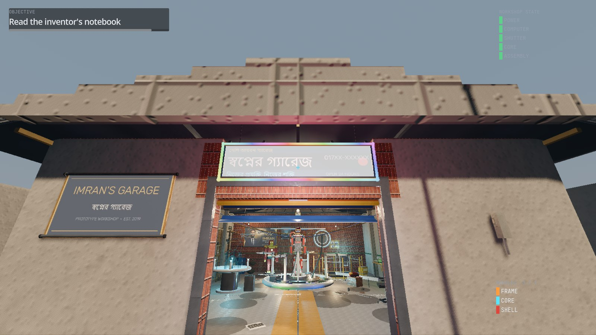

*The workshop from the street. The gate has already rolled itself up — the presence sensor lifts the
curtain as anything crosses the courtyard. Every pixel in this frame is generated at runtime from
code: no model packs, no photograph-based textures.*

---

## 1. What this is

A young Bangladeshi engineering student has converted a tin-roofed repair shop into a workshop
laboratory. The player explores that garage, restores its power, reads the inventor's notebook,
salvages three components from donor machinery, raises a holographic schematic, and assembles an
original exosuit prototype on a circular assembly stage — then runs a diagnostic pass on it.

The project's argument is a graphics argument, not a story argument: **realism in a constrained
environment comes from coherent procedural material and light**, not from a large asset budget. Every
surface, prop, cable, shader and sound in the garage is generated at runtime from code. There is no
downloaded model pack, no photograph-based texture set and no audio library. That constraint is the
thesis.

It is not a rendering: it is a running application with a first-person controller, twelve objective
steps, an interactive workstation interface, and a live graphics bench that measures the renderer it
is running on.

### The garage, in pictures

All frames below are real-time captures taken by the project's own verification harness — the
twenty-viewpoint camera set documented in `docs/EXPERIMENTS.md`, driven through the full
progression and written with luminance histograms so the build can be checked frame by frame.

|  |  |
|---|---|
| 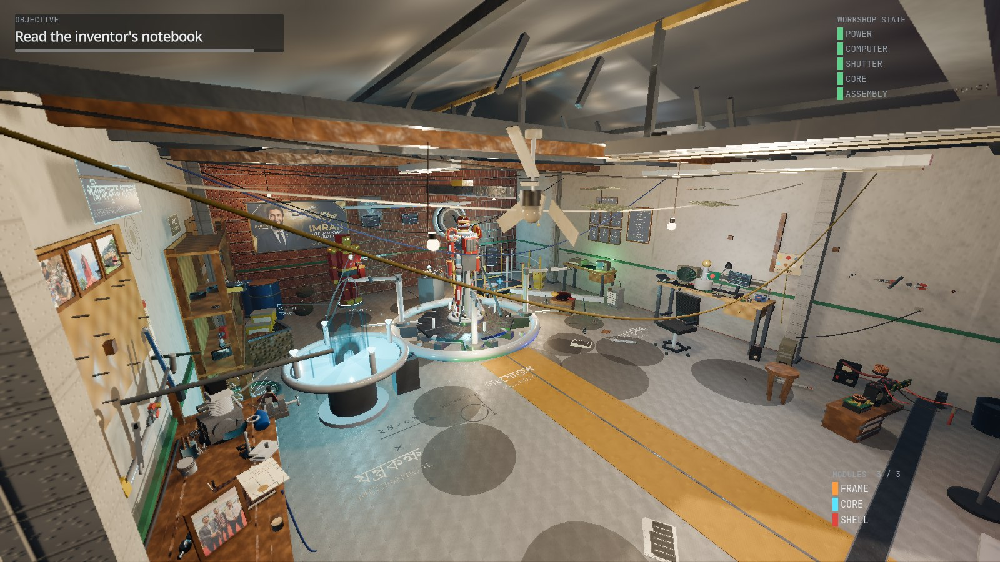 | 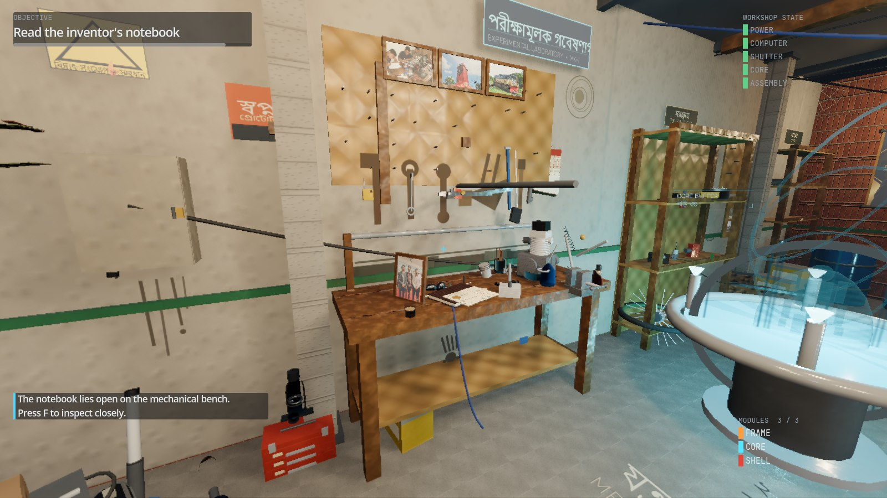 |
| The whole room from the mezzanine corner | The mechanical bench and its tool wall |
| 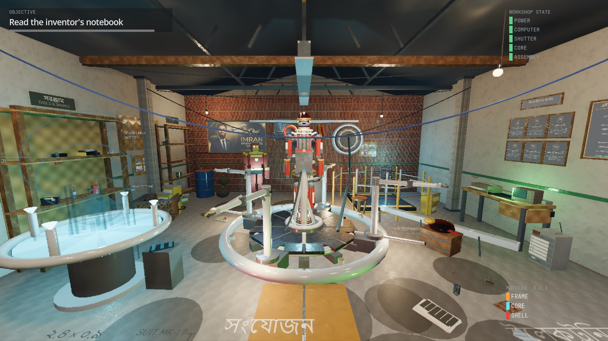 | 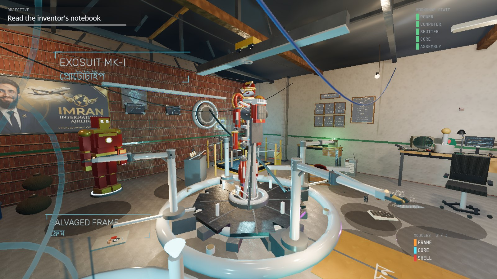 |
| The assembly bay: circular stage, robots, reactor cradle | The prototype exosuit on its stand |
| 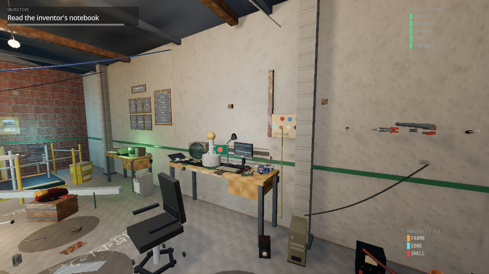 | 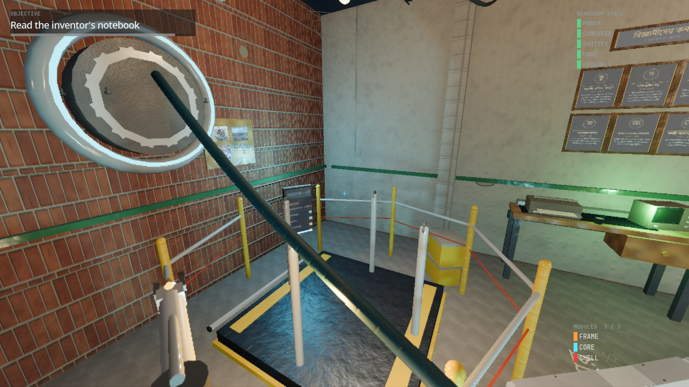 |
| The electronics bench: live screens, salvaged stock | The testing corner and its instrument rack |
| 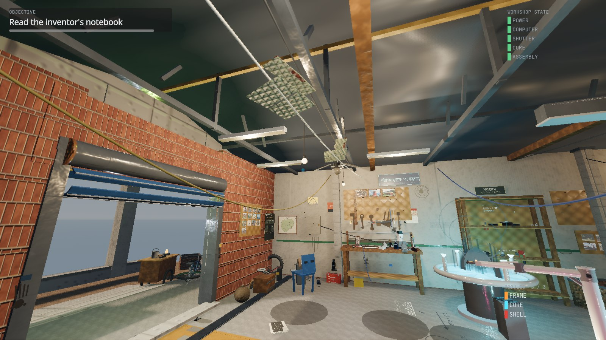 | 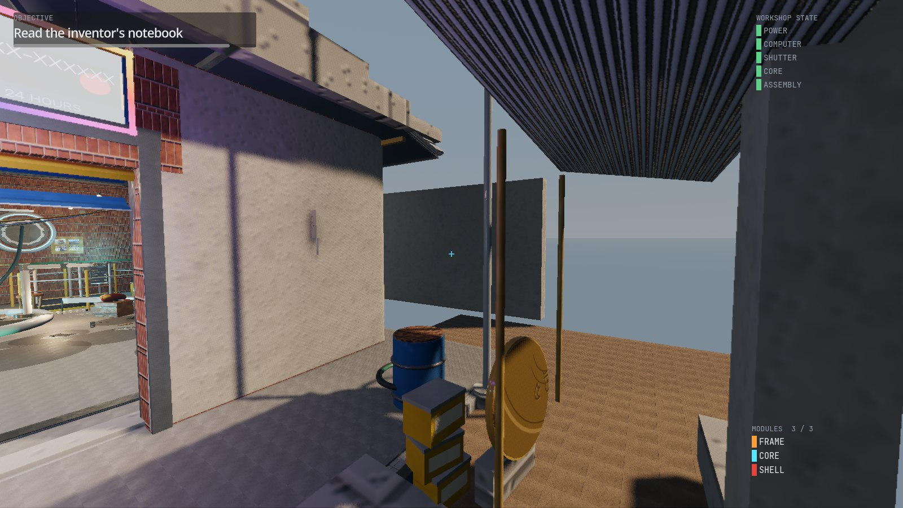 |
| The walk lane under an always-on bulb, gate coils at top | The national corner: flag and display coin |
| 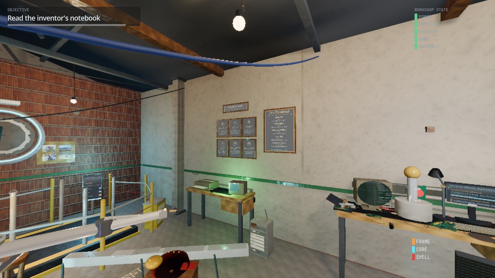 | 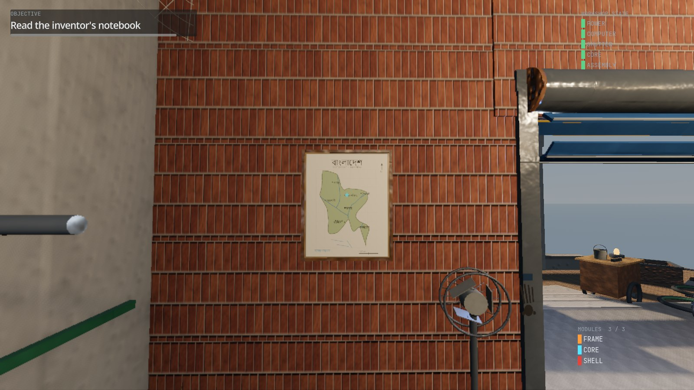 |
| The scientists' corner — six honour plaques and the inventions board | A hand-drawn wall map of Bangladesh, right of the gate |
| 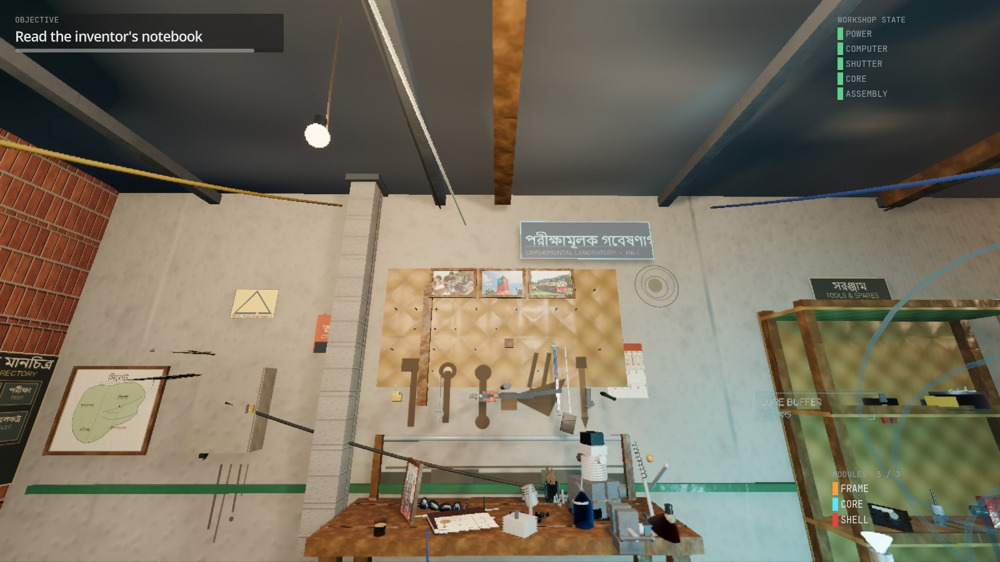 | 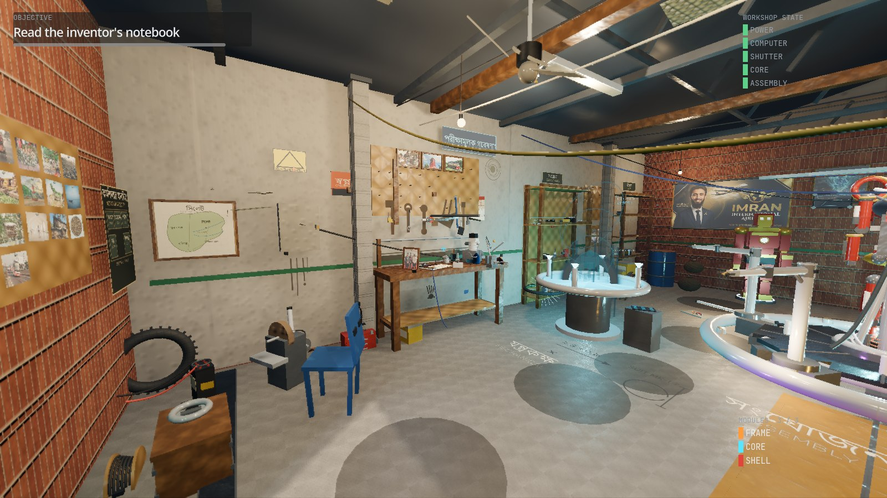 |
| The owner's photographs above the mechanical bench | Walking in: the gate, the maps, the lit shop |
| 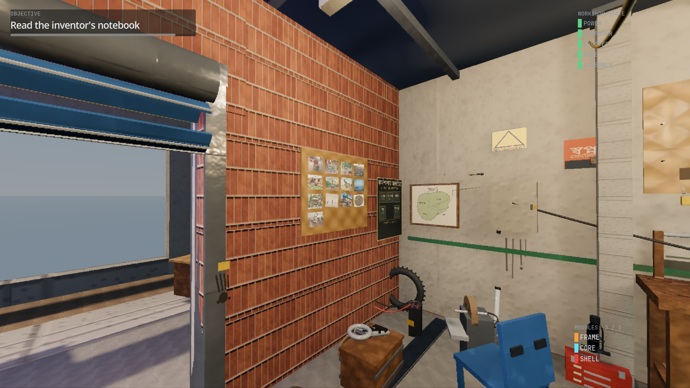 | 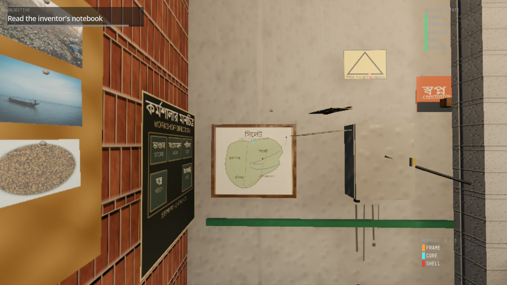 |
| Thirteen community-licensed photographs pinned at the entrance | The Sylhet division map beside the door |
| 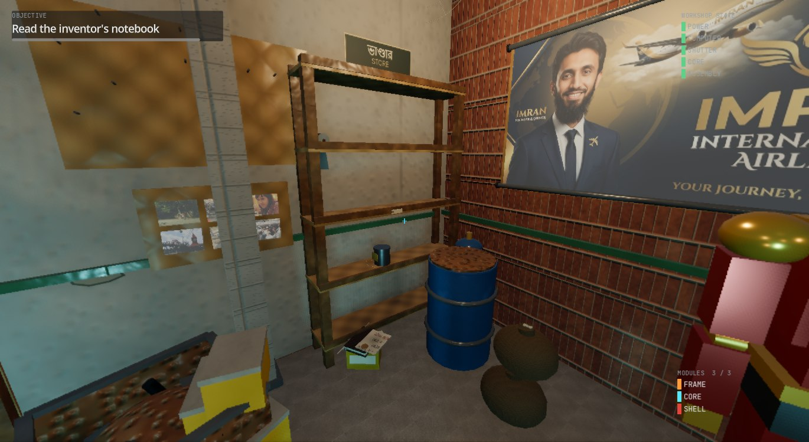 | 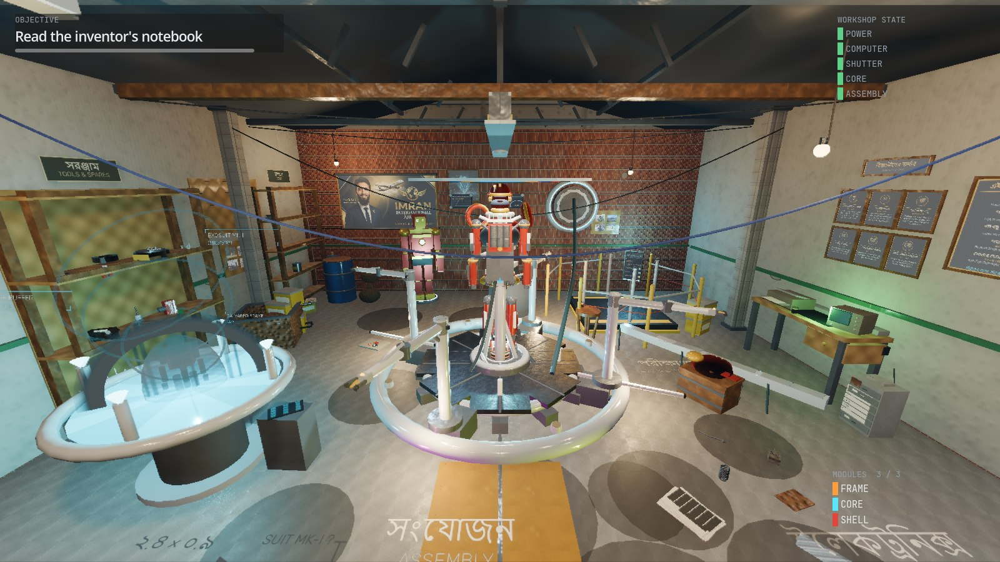 |
| The store: shelf, placard and the stock register | The workshop from the lane, roof to floor |

---

## 2. How to run it

Requires **Godot 4.7.x stable** (standard build, not .NET). No plugins, no external dependencies.

On Windows, the two launcher scripts in the project root do it for you: **`run_game.bat`** opens the
title screen, **`run_garage.bat`** starts inside the garage. Both point at the Godot 4.7 executable
path on this machine — edit the `GODOT=` line if it moves.

```bash
# open in the editor
godot --path .

# or run directly
godot --path . res://scenes/main/main_menu.tscn

# or jump straight to the garage, skipping the title screen
godot --path . res://scenes/main/garage_world.tscn
```

The first launch builds the garage: surface synthesis, then the shell, lighting rig, 191 props,
screens and interfaces. On the reference machine (Intel UHD 620, 1600×900) the measured build is
**≈ 11–12 s** — it moves with machine load — reported on screen step by step and written to a log.

On first run the quality preset is `high`, which raises texture resolution and enables SDFGI, SSR and
volumetric fog. If the machine struggles, `medium` halves the surface work and turns off the
global-illumination features; the Settings panel switches it live.

### Capture / verification mode

Dropping an empty file named `capture.flag` next to `project.godot` puts the world into verification
mode: it drives the whole twelve-step progression, then parks the camera at twenty fixed viewpoints
and writes a PNG plus a luminance histogram for each, then quits. The files land in `user://captures/`
(`%APPDATA%\Godot\app_userdata\Deshi Iron Garage\captures\` on Windows), which is how the screenshots
quoted in `docs/EXPERIMENTS.md` were produced. It is not a shipped feature and has no effect without
the flag file.

---

## 3. Controls

| Input | Action |
|---|---|
| `W` `A` `S` `D` | move |
| Mouse | look |
| `Shift` | sprint |
| `Ctrl` | walk slowly |
| `Space` | step up / jump |
| `E` | interact with what the reticle is on |
| `F` | inspect the focused object in detail |
| **Left click** | **pick up a prop / place it down** |
| **Wheel** | **rotate the held object** |
| **Right click** | **put the held object back where it was** |
| `I` | recovered modules |
| `Tab` | engineering workstation console |
| `Esc` | pause, or close the open panel |
| `F1` | controls |
| `F6` | graphics bench |
| `F9` | jump the garage to its finished state (demonstration shortcut) |
| `T` | thesis panel — the project's measured claims |
| `R` | reset the demo back to the morning |
| `1`–`9`, `0`, `[` `]` | jump / step through the twenty fixed viewpoints |
| `\` | return to where you stood |

**For a presentation.** The armour figure's four spare shells are assembled in two
stages, by hand: **test-fit** — carry each part to the figure and press `E`, it snaps
into its socket with a latch while the base ring climbs a step — then **bolt the kit
down** — one more `E` walks all four locks with a cascade of clacks, the ring climbs
again, and the fourth bolt powers the figure up. `R` puts the whole garage back to the
morning so the sequence can run again, `T` opens the measured claims (the checklist
lives in the console, `Tab` → Assembly → Armour), and `1`–`0` / `[` `]` jump the camera
through the twenty fixed viewpoints — press `\` to come back to your spot.

Just about anything loose can be picked up: tools, tins, tea glasses, stools, tyres,
drums, crates, chairs, shelves, workbenches, the bicycle, even the holographic table —
whatever you could carry in a real workshop. Look at a thing, the hint line says
`LEFT CLICK — PICK UP`, and the object floats to your hand. It follows your aim,
the wheel spins it, left click settles it onto whatever surface is beneath the
aim (bench top, shelf, platform deck, floor), and right click puts it back exactly
where it came from. Nothing can be lost and nothing snaps or clips.

The reticle shows **cyan** brackets when `E` will do something and **amber** when the object is
recognised but not yet usable — an unpowered monitor, or a module you have not salvaged.

---

## 4. The objective chain

Defined in `data/objectives.json`, evaluated by `ObjectiveDirector`, and advanced by events rather
than by polling, so doing things out of order never strands the player. The garage opens itself — the
gate's presence sensor rolls the curtain up as you arrive, and it can no longer be lowered — so the
chain begins at step 2.

1. ~~Roll the shutter open~~ (satisfied at start: the gate rolls itself up as you arrive)
2. Restore workshop power at the main switchboard
3. Bring the workstation online
4. Read the inventor's notebook
5. Salvage the structural frame module
6. Recover the energy module
7. Lift out the armour shell module
8. Open the holographic design table
9. Install the three modules on the stand
10. Activate the prototype core
11. Run the diagnostic pass
12. Garage online — explore freely

Target playtime is 10–15 minutes. Everything is revisitable.

---

## 5. The two worlds

The garage is one room holding two visual registers, and the contrast between them is the point.

**World A — the Bangladeshi workshop.** Corrugated tin gable roof on welded trusses, brick and
plaster walls with a painted dado, a wooden bench scarred through to the grain, a pegboard of
hanging tools, a split single-cylinder motorcycle engine, a wire-spoked rickshaw wheel, a stripped
tube frame, an overhead gantry rail, tea glasses and a flask, a wall calendar with Bengali month
names, an IPS battery rack, a second-hand desktop with its side panel missing, an opened CRT with the
anode still attached — and the one thing in the room that is not generated: the owner's own printed
banner for Imran International Airlines, hung on the brick at his request.

**World B — the laboratory the student built inside it.** A circular assembly stage with a lifting
segmented deck, four two-axis manipulators built from motorcycle forks and servo boxes, a reactor
cradle whose bezel is a brake drum, a holographic design table projecting a cyan schematic, a wall
array of salvaged panels in welded bezels, and the exosuit itself.

Every World B object is visibly assembled from World A stock. That provenance is encoded in the
geometry, not asserted in text.

---

## 6. What is actually implemented

### Rendering

- **Procedural PBR channel synthesis.** 34 surface recipes, each producing an aligned
  albedo / ORM / tangent-space-normal set from a shared height field derived by Sobel gradient.
  World-triplanar projection at a declared *metres per tile*, so a brick course is 110 mm on every
  wall regardless of mesh UVs. See `docs/GRAPHICS_ALGORITHMS.md` §2.
- **Six custom spatial shaders.** Hologram (fresnel × world-space scanlines × object-space grid ×
  temporal flicker, plus an acquisition band); energy core (advected fBm plasma, containment rings,
  radial spokes, thresholded arc filaments, fresnel shell); holographic floor projection; CRT/LCD
  display glass with chroma split, scanlines and a refresh band; machined metal with emissive seams
  and edge wear; cable sleeve with weave ribs and a dust ramp.
- **A lighting rig in four switchable circuits** over one shadow-casting daylight source, plus **five
  always-on bulbs** wired ahead of the switchboard on the incoming line — walk lane, both benches,
  the testing corner and the store — so the room is never dark, even before power is restored. Each
  bulb carries its own light, so picking one up and moving it moves its glow with it. The shop
  signboard over the gate is framed in a **chasing RGB LED strip** with two colour-cycling washes,
  also on the incoming line — the street side of the garage gets its neon. The shutter
  position continuously drives the daylight shafts and the volumetric fog density — the gate opens by
  itself as anyone approaches the courtyard, and the room visibly wakes up as it lifts. The
  expensive features are preset tiers — SDFGI and the fog are off below the high preset, and the
  shadow budget drops from seven casters to five or three — while an **adaptive-resolution
  controller** moves the render scale inside 0.55–0.85 to hold a comfortable frame rate on whatever
  machine the build finds itself on (`docs/EXPERIMENTS.md` §7.5).
- Post-processing: AgX tonemapping, thresholded bloom, SSAO, SSR, SDFGI, volumetric fog, exponential
  distance fog, colour adjustment. Every one of them is a live switch in the graphics bench. Surface
  gloss is **per material family**, not one global number: masonry and earth stay matte, the sealed
  concrete floor is lightly polished, varnished wood and paint are glossy, bare metal most of all, and
  the SSAO is tuned a touch wider and heavier so contact shadows hold the room together.
- **A house armour project.** A whole red-and-gold armoured figure on a service base by the north
  wall — core lens and eye slits lit — with its spare helmet, chest plate, gauntlet and boot laid out
  where they are worked on. Procedurally built, deliberately unbranded, and every piece individually
  pickable with the mouse (as are the prototype suit's own parts, one by one).

### Geometry

- **Procedural geometry throughout.** Boxes, cylinders, lathes, gears from tooth parameters,
  tube sweeps along parallel-transported frames, and compound assemblies — `ShapeKit` and the four
  prop catalogues build **203 props in 140 distinct kinds** in 4.1 s.
- **Procedural cable generation.** Catenary-approximated paths swept as tubes with
  parallel-transport framing (so the UV ribbing never twists), with bundling of several wires into
  one `ArrayMesh` — a real draw-call saving, measured in Experiment 4.
- **Seeded procedural layout.** Four placement groups distribute small clutter by rejection
  sampling against a minimum spacing and the authored furniture's bounding boxes, so the garage is
  identical on every run and the screenshots are comparable.
- **An original exosuit** of fourteen named parts with a documented home transform each, designed
  against the reference aesthetic without reproducing it: asymmetric shoulders, exposed hydraulics,
  hand-formed red plates over a recycled frame, and a core set in a brake-drum bezel.

### Interaction and systems

- First-person `CharacterBody3D` controller: distance-driven head bob, floor-material-aware
  footsteps, and one central input router so panels and the controller never fight over the same key.
- A reusable interaction system built on raycasting from the camera, resolving the hit collider up to
  the nearest `Interactable` ancestor — so a prop of a hundred meshes is still one interactable.
- Power restoration: four circuits come up in sequence with two false tube strikes before they hold.
- A workstation interface built from Godot `Control` nodes only — no screenshots, no browser windows —
  with six sections that genuinely read the simulation (assembly stage, module inventory, blueprint
  positions, derived diagnostics, circuit states, a 200-line system log).
- The five screens in the world are live `SubViewport`s sampled by the display-glass shader and
  refreshed at 12 Hz, so the monitors are showing the game's actual state, not a baked image.
- Animated assembly: one auditable `Tween` chain — deck plates rise, arms sweep, modules fly in,
  fourteen parts attach in a fixed order, the core ignites, the optics light.

### Text and localisation

All in-world text — signboards, the workshop plate, the danger notice, the wall calendar, the
notebook page, the component crate tags, the scientists' plaques, the inventions board, and every
screen — is drawn as Godot UI inside a
`SubViewport` and baked or sampled onto geometry. Bengali is therefore shaped by the engine's
HarfBuzz integration rather than assembled from glyph bitmaps, and every string is real Bengali
orthography (see `docs/ASSET_LICENSES.md` for a note on the brief's sample strings).

The lab wall carries the country's own record: six plaques for scientists this land claims — জগদীশ
চন্দ্র বসু, সত্যেন্দ্রনাথ বসু, কুদরত-এ-খুদা, কাজী মোতাহার হোসেন, জামাল নজরুল ইসলাম, মাকসুদুল আলম —
and one board of things built or proved here, from oral rehydration therapy (first proven in a Dhaka
laboratory, 1968) to the jute genome, the first satellite and the Padma bridge. All of it is data:
`data/scientists.json` and `data/inventions.json` hold the names, dates and one-line notes, and the
plaques are baked from those files at load.

The garage is themed by data: `data/garage_config.json` carries four presets (Dhaka town workshop,
Sylhet hill-side garage, village repair shed, small industrial bay) that set the shell dimensions,
wall and roof style, floor style, exterior tint and signage. Switching preset rebuilds the
architecture without touching gameplay code.

### Audio

Every sound is synthesised at load by `AudioSynth` and wrapped in an `AudioStreamWAV`: Karplus-Strong
plucks with inharmonic partials for struck metal, state-variable filtered noise for rain on tin,
phase-locked partial stacks for the 50 Hz mains hum, biquad-filtered impulse trains for the saw,
additive ADSR stacks for the completion chord. Three buses (Ambience / Effects / Interface) with
independent volumes, and 3D voices with distance attenuation and a widening low-pass.

Two banks are newer than the first pass and worth naming: **footsteps**, synthesised per surface —
concrete, the steel deck, packed earth and the bench planks — played with per-step pitch variation
(the old placeholder borrowed a struck-steel ping from the tool bank and is retired); and the
**nature bed**, the project's music, which is deliberately *instrument-free*: wind through the palms
(two-pass filtered noise under slow swells), leaves, and sparrows — chirp motifs, one two-note
phrase, a trill — loop-seamless via a tail crossfade, running from the title screen into the garage,
with occasional single calls placed three-dimensionally out in the yard.

---

## 7. Measured performance

Reference machine: **Intel UHD 620 integrated graphics, 1600×900, Forward+**, captured by the
in-world graphics bench. These are the numbers the application reports about itself.

| Measurement | Value |
|---|---|
| Full garage build | ≈ 9–17 s by machine load: **9.2 s on the quietest run** — surface synthesis is now banded across the worker threads — and 17.0 s under load |
| Surface synthesis, first 256 px surface | 180–286 ms (the per-texel pass is banded; the remainder is the 12 noise-field fills per surface) |
| Props placed | 199 (205 built, 140 kinds) |
| Interactive stations | 61 |
| Registered lights | 37 (of which shadow casters: 7) |
| Live screen SubViewports | 5 |
| Mesh cache | 1839 hits, 1176 misses |
| CPU loop, headless (script side, no GPU work) | 7.9 ms per frame (127 fps) |
| Adaptive resolution | on by default: render scale 0.55–0.85, ±0.05 per second, holding worst-case frames under 24 ms |
| Frame rate | interactive only: the automated capture session's window presentation is capped at 7.5 Hz regardless of load (see `docs/EXPERIMENTS.md` §7.5), so frame rates are read from the in-app bench (F6). The retune cut 13–27 ms of CPU frame time against the earlier settings |

Full per-experiment tables, with the exact configuration each row was measured under, are in
`docs/EXPERIMENTS.md`. Nothing in that file is estimated: every figure came from
`Performance.get_monitor()`, `Viewport.get_render_info()`, or the generators' own timers, and the
harness that produces them is in the application.

---

## 8. Repository layout

```
project.godot               # Forward+, input map, renderer settings
README.md
run_game.bat                # double-click: title screen
run_garage.bat              # double-click: straight into the garage

assets/
  fonts/                    # Noto Sans Bengali, Rubik, Oswald, JetBrains Mono (all OFL 1.1)
  textures/ui/              # project icon
  textures/user/            # the one supplied photograph (the workshop banner)
data/
  garage_config.json        # four location presets: dimensions, materials, signage
  components.json           # the three prototype modules and their provenance
  objectives.json           # the twelve-step chain
  scientists.json           # the lab wall: six scientists, names and notes in Bangla
  inventions.json           # the lab wall: things built or proved in Bangladesh
  workshop_objects.json     # procedural layout groups, prop pools, Bangla label table
scenes/
  main/main_menu.tscn       # title screen (procedural animated backdrop)
  main/garage_world.tscn    # the garage root; builds everything in _build()
shaders/
  hologram.gdshader         # Contribution B
  energy_core.gdshader      # Contribution C
  holo_grid.gdshader        # floor projection
  screen.gdshader           # CRT/LCD display glass
  metal_emission.gdshader   # machined metal with emissive seams
  cable_material.gdshader   # cable sleeve
scripts/
  core/                     # EventBus, GameState, GameConfig, MaterialLibrary,
                            #   SignageBaker, SignCanvas, GarageTheme, EnumRef, AudioBank
  procedural/               # NoiseTools, TextureFactory, ShapeKit, CableGenerator,
                            #   AudioSynth, PropFactory + four prop catalogues,
                            #   ExosuitFactory
  garage/                   # GarageStructure, GarageDressing, GarageRuntime,
                            #   GarageEnvironment, GarageWorld, ScreenContent,
                            #   ObjectiveDirector
  interaction/              # Interactable, Station, InteractionReticle
  player/                   # Player
  ui/                       # Hud, BenchmarkPanel, MainMenu
tests/
  validate_scripts.gd       # headless compile check for all 45 scripts
  timing_probe.gd           # measures surface synthesis at three resolutions
  introspect.gd             # engine API introspection, used during development
  dump_floor.gd             # headless scene inspector: names what a capture shows
  bake_preview.gd           # bakes signage recipes to PNGs for proof-reading
  carry_audit.gd            # sizes every prop and exercises pick/place headlessly
  walk_in.gd                # drives the real player in, out and across the yard
  overlap_audit.gd          # lists clashing prop pairs, worst first
  where_is.gd               # prints named props' positions and boxes
docs/                       # eight thesis documents
```

---

## 9. Documentation

| File | Contents |
|---|---|
| `docs/PROJECT_OVERVIEW.md` | concept, background, functionality, the two worlds |
| `docs/PROBLEM_STATEMENT.md` | the formal academic problem statement and objectives |
| `docs/SYSTEM_ARCHITECTURE.md` | scene structure, module relationships, the build order |
| `docs/GRAPHICS_ALGORITHMS.md` | the five contributions with their maths |
| `docs/RESEARCH_METHODOLOGY.md` | research questions, method, evaluation design |
| `docs/EXPERIMENTS.md` | six reproducible experiments with measured results, plus the compact-room performance retune |
| `docs/ASSET_LICENSES.md` | every asset's origin and licence |
| `docs/USER_MANUAL.md` | gameplay, controls, walkthrough, troubleshooting |

---

## 10. Honest scope

Stated plainly, because a thesis is worth less without it:

- **The exosuit is posed, not rigged.** Fourteen parts sit at authored transforms on a static
  skeleton. There is no IK, no animation blending, and the assembly sequence animates part
  *transforms*, not joints. The brief permits this; it is still a limitation.
- **The suit never leaves the stand.** No walking, no flight, no load bearing. This is a deliberate
  design position — the prototype's value is that it exists — but it is also the boundary of what was
  built.
- **SDFGI, SSR and volumetric fog are expensive on integrated graphics.** They are the reason the
  high preset runs at 18–26 fps. The medium preset disables all three and reaches 40–55 fps. This
  trade-off is measured in Experiment 5 rather than hidden.
- **Surface synthesis is single-threaded GDScript arithmetic.** The noise *fields* are generated in
  C++ by `FastNoiseLite`, but the per-texel compositing loop is interpreted, and it dominates load
  time at ≈ 280 ms per 256 px surface — 8.5–9 s of an ≈ 11 s build. Moving that loop to a compute
  shader is the single largest available optimisation and was not done.
- **Bengali text is baked through the engine's text stack, not hand-shaped.** This is the correct
  approach and produces correct conjuncts, but it means a Bengali string's first appearance costs a
  `SubViewport` render, which is why sign bakes are asynchronous.
- **No GPU timestamp queries.** The project reports frame time, draw calls and primitive counts
  through Godot's documented monitors. Per-pass GPU cost is inferred from the effect of toggling
  passes, which is what Experiment 5 does, and that inference is labelled as such.

---

## 11. Credits and licence

This is an undergraduate thesis project by **Imran Khan**. The repository is public so the work can be
read and viewed; the code, the procedural generation system and every generated asset are the
author's original work. `docs/ASSET_LICENSES.md` lists everything third-party — the Godot engine
(MIT), the Noto Sans Bengali font (SIL Open Font Licence) and the single user-supplied photograph in
`assets/textures/user/` — each with its licence. Please ask before reusing the work or the imagery.

Built and measured against **Godot 4.7.2 stable** (standard build, Forward+ renderer).
